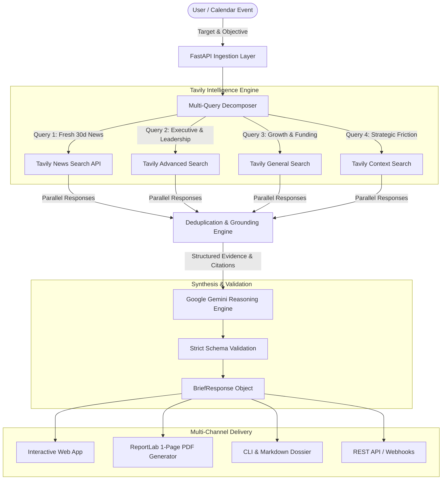

# BriefPilot 🧭
### Autonomous Pre-Meeting Executive Intelligence Agent
**Submission for the Global AI Hackathon 2026 (HackCulture / Geek Room)**  
*Primary Theme:* **AI Agents & Intelligent Systems**  
*Track:* **Tavily: Pre-Meeting Briefing Agent**  
*Team:* **shahaman098** (Solo — Aman Kumar Sah / Kris, Brunel University London AI)

[](LICENSE)
[](https://python.org)
[](https://fastapi.tiangolo.com)
[](https://tavily.com)
[](https://deepmind.google/technologies/gemini/)

---

## 🎯 1. Problem Statement & The Pre-Meeting Blindspot

In high-stakes business environments (B2B enterprise sales, venture capital pitches, partnership syncs, and executive hiring), entering a meeting unprepared or relying on stale information leads to lost deals and damaged trust.

1. **The Time Drain:** Knowledge workers spend **4–6 hours every week** manually searching LinkedIn, X, Google News, and corporate press pages to piece together background context.
2. **The Stale Information Void:** General search engines rank content by SEO authority and historical traffic. They frequently surface articles from 6–12 months ago while missing breaking product releases, funding rounds, or leadership departures that occurred in the **last 30 days**.
3. **The Hallucination Danger:** Using raw foundation models without real-time grounding causes models to invent dates, confuse executive names, and fabricate initiatives.

**BriefPilot solves this.** In under 5 seconds, BriefPilot performs targeted 30-day temporal research across news and corporate statements via the **Tavily Search API**, filters and scores the findings, and synthesizes a high-leverage one-page executive briefing complete with verified source citations, strategic opportunities, conversation starters, and red flags.

---

## 💡 2. Solution Overview & Key Features

BriefPilot operates as an autonomous agent pipeline:

* **Dual Entity Resolution:** Generates customized briefings for either **Companies / Organizations** or **Individual Executives**.
* **Objective-Driven Research:** Customizes the briefing to your exact meeting goal (e.g. *"Enterprise partnership pitch"*, *"Angel investment round"*, *"CTO hiring interview"*).
* **30-Day Fresh Intelligence Timeline:** Chronological, categorized timeline (Funding, Product, Leadership, Partnerships) grounded in articles published within the last 30 days.
* **Strategic Value Levers:** Directly maps the target's recent pain points or growth areas to your meeting proposal.
* **High-Impact Talking Points:** Ready-to-use conversational openers with suggested natural phrasing.
* **Sensitive Landmines & Red Flags:** Flags recent controversies, product delays, or competitor threats to avoid embarrassing missteps.
* **100% Grounded Citations:** Every claim links directly to its verbatim source URL, title, and published timestamp.
* **Multi-Channel Delivery:** 
  - Responsive Web Dashboard (FastAPI + Tailwind CSS)
  - One-Click Downloadable One-Page PDF Dossier (ReportLab)
  - Scriptable CLI tool for power users and cron jobs
  - RESTful JSON API for CRM, Slack, and Google Calendar automation

---

## ⚡ 3. Why Tavily is the Core Engine

BriefPilot relies on the **Tavily Search API** because general search engines and scraping bots cannot meet the latency, freshness, and structure requirements of autonomous agents:

| Feature | Generic Search / Scraping | Tavily Search API |
| :--- | :--- | :--- |
| **Temporal Precision** | Biased towards older high-SEO pages | Strict `time_range="month"` filters past 30 days |
| **News Filtering** | Mixed forum, spam, and stale blogs | Dedicated `topic="news"` pulls authoritative releases |
| **Response Latency** | 5–15 seconds (scraping + headless browsers) | **Sub-second (400–800ms)** API responses |
| **Data Format** | Messy HTML with CSS / ads / popups | Clean, LLM-ready markdown snippets & citations |
| **Direct Answers** | Snippets often cut off context | Synthetic contextual Q&A answers included |

---

## 🏗️ 4. Technical Architecture



---

## 🛠️ 5. Tech Stack

* **Backend & API:** Python 3.12, FastAPI, Uvicorn, Pydantic v2
* **Search & Intelligence:** [Tavily Search API](https://tavily.com) (`tavily-python` SDK)
* **Reasoning & Grounding:** Google Gemini API (`gemini-3.5-flash`)
* **PDF Engine:** ReportLab Platypus (one-page executive layout)
* **Frontend:** Tailwind CSS, FontAwesome 6, Plus Jakarta Sans, Modern Glassmorphism
* **Presentation:** `python-pptx` (PowerPoint) & ReportLab (PDF pitch deck)

---

## 🚀 6. Getting Started & Installation

### Prerequisites
* Python 3.10+ (or [uv](https://github.com/astral-sh/uv))
* Tavily API Key ([Get one at app.tavily.com](https://app.tavily.com))
* Google Gemini API Key ([Get one at aistudio.google.com](https://aistudio.google.com))

### 1. Clone the repository
```bash
git clone https://github.com/shahaman098/briefpilot.git
cd briefpilot
```

### 2. Set up environment
Create a virtual environment and install dependencies:
```bash
python3 -m venv .venv
source .venv/bin/activate
pip install -r requirements.txt
```
*(Or with uv: `uv venv && uv pip install -r requirements.txt`)*

### 3. Configure credentials
Copy `.env.example` to `.env`:
```bash
cp .env.example .env
```
Edit `.env` with your API keys:
```ini
TAVILY_API_KEY=tvly-your-tavily-api-key
GEMINI_API_KEY=your-gemini-api-key
GEMINI_MODEL=gemini-3.5-flash
PORT=8000
```

### 4. Run the Web Dashboard
```bash
python -m src.main
```
Open your browser at `http://localhost:8000`.

### 5. Run via CLI
You can also generate briefings directly in your terminal:
```bash
python -m src.cli \
  --target "Tavily AI" \
  --type company \
  --objective "Explore embedding Tavily Search API into enterprise pre-meeting workflow" \
  --out-pdf artifacts/tavily-brief.pdf \
  --out-md artifacts/tavily-brief.md
```

---

## 🧪 7. Verification & Sample Output

BriefPilot includes a built-in instant evaluation sample (`GET /api/sample`) demonstrating a real briefing generated for **Tavily AI**:
* **30-Day Timeline:** Covers Nebius Cloud acquisition and integration, 350M+ query milestones, and Remote MCP launch.
* **Talking Points:** Phrasing for querying high-concurrency rate limits, caching layers, and agent MCP schemas.
* **Red Flags:** Clarifying difference between raw web scrapers and LLM-optimized agent search.

---

## 📊 8. Pitch Deck & Documentation

* **PowerPoint Presentation:** [`docs/pitch-deck.pptx`](docs/pitch-deck.pptx)
* **PDF Presentation:** [`docs/pitch-deck.pdf`](docs/pitch-deck.pdf)
* **Sample 1-Page PDF Brief:** [`artifacts/sample-brief.pdf`](artifacts/sample-brief.pdf)
* **Submission Checklist:** [`SUBMISSION.md`](SUBMISSION.md)

---

## 👤 9. Author & Acknowledgments

* **Developer:** Aman Kumar Sah (Kris)
* **GitHub:** [@shahaman098](https://github.com/shahaman098)
* **HackCulture Team:** `shahaman098`
* **Hackathon:** Global AI Hackathon 2026 organized by Geek Room & HackCulture.
